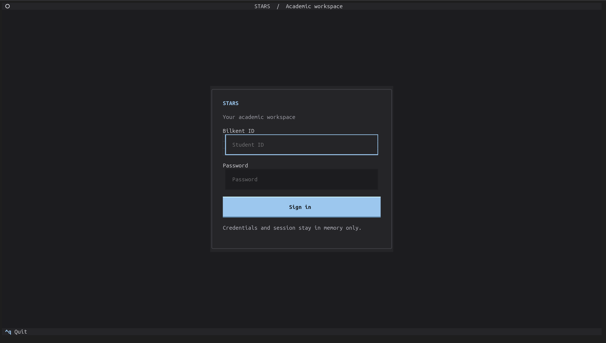

# STARS CLI

An unofficial terminal dashboard for Bilkent STARS/SRS.



## Features

- Browserless password and SMS login with masked inputs.
- Profile sidebar, current courses, weekly timetable, and scheduled exams.
- Dark theme, mouse and keyboard navigation, and responsive tables.
- In-memory sessions; no saved credentials, cookies, or academic records.

## Setup

Requires Python 3.11+ and [uv](https://docs.astral.sh/uv/).

```bash
uv venv .venv-stars-cli
uv pip install --python .venv-stars-cli/bin/python -e .
source .venv-stars-cli/bin/activate
srs
```

Use `srs --classic` for the original line-based login. If your terminal sets
`NO_COLOR`, run `env -u NO_COLOR srs` to enable colors.

**Controls:** `1`–`3` switch tabs, `Tab` changes focus, arrows navigate,
`R` refreshes, and `Ctrl+Q` exits. Mouse selection and scrolling are supported.
Logout clears the local session.

## Development

```text
src/        Application code
tests/     Offline tests with fabricated data
images/     README screenshots
```

```bash
.venv-stars-cli/bin/python -m unittest discover -s tests -v
```

Read-only, personal account access only. This project is not affiliated with
Bilkent University. Changes to SRS page layouts may require parser updates;
local tests do not verify live authentication or every server response.
